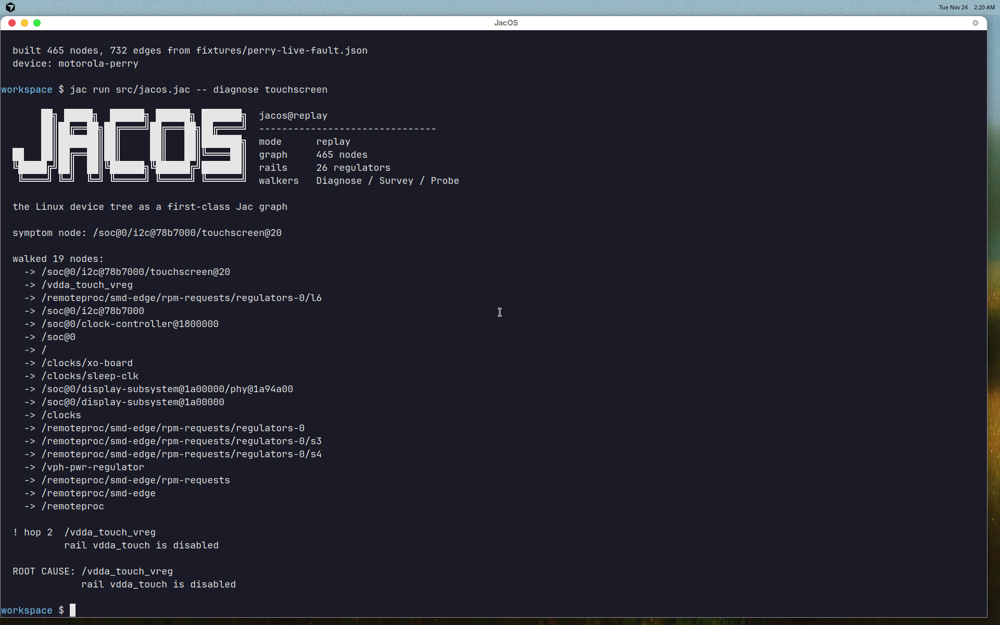

# JacOS

[](https://github.com/aneesh-pradhan/jacOS/actions/workflows/ci.yml)

JacOS loads a Linux device tree into a Jac graph, so "the touchscreen is dead, why?" is a walk along the power, clock, reset, and bus edges.

The device tree already records those links as phandles (`vdd-supply = <&pm8937_l6>`, `clocks = <&gcc 42>`). `tools/dtb.py` turns each phandle into a typed edge, `src/importer.jac` materialises the graph, and the `Diagnose` walker assesses every hop it arrives on. A regulator is healthy when its rail is enabled. A device is healthy when a driver has bound. The walker dispatches that check by node type:

```jac
can check_regulator with Regulator entry { ... }
can check_device    with Device    entry { ... }
can descend with HwNode exit {
    visit [->:SuppliedBy:->];
    visit [->:ClockedBy:->];
    visit [->:ResetBy:->];
    visit [->:ParentBus:->];
}
```

The committed capture below is a Motorola Moto E4 (`motorola-perry`) running postmarketOS: 465 nodes and 732 edges, read out of the booted kernel. Replaying it needs no phone.

## Demo



Screenshot of a real session on Ubuntu 24.04 with jaclang 0.16.7 and `JACOS_MODE` left to auto-detect. This machine has no `/sys/firmware/devicetree/base`, so the banner reads `replay`. The two commands were:

```bash
jac run src/jacos.jac -- build fixtures/perry-live-fault.json
jac run src/jacos.jac -- diagnose touchscreen
```

`fixtures/perry-live-fault.json` is the same 465-node capture with the touchscreen rail turned off. The walker printed:

```
  symptom node: /soc@0/i2c@78b7000/touchscreen@20

  ! hop 2  /vdda_touch_vreg
           rail vdda_touch is disabled

  ROOT CAUSE: /vdda_touch_vreg
              rail vdda_touch is disabled
```

The full 19-node trail is in the screenshot. Nothing in that session was typed in by hand past the two commands.

## What works without hardware

Replay is the default when `/sys/firmware/devicetree/base` is absent. Set `JACOS_MODE=replay` to force it on a machine that does have a device tree. CI does this.

| Fixture | What it is | Verified result |
|---|---|---|
| `fixtures/perry-live.json` | Moto E4 capture, 465 nodes, 732 edges | `diagnose touchscreen` finds no fault on that path. `health` assesses 465 nodes and reports 13 findings (rails that are off in the capture, plus `labibb` with no driver). |
| `fixtures/perry-live-fault.json` | Same tree, `vdda_touch` disabled | Root cause `/vdda_touch_vreg`, rail disabled. This is the screenshot. |
| `fixtures/perry.json` | Synthetic 11-node tree | `python3 tools/dtb.py --synthesize` reproduces this file byte for byte. |
| `fixtures/perry-fault.json` | Synthetic tree, `pm8937_l10` disabled | Root cause `/soc/spmi@200f000/pmic@0/regulators/l10`. |
| `fixtures/pizero-live.json` | Raspberry Pi Zero W capture, 162 nodes, 247 edges | Same walkers. `health` reports `cam1-reg` disabled. |

`build`, `graph`, `health`, and `diagnose` all run against these files. `diagnose -x` also runs offline: with no `OPENAI_API_KEY`, byLLM returns its built-in mock `Diagnosis` (see below). The web console (`src/main.jac`) is a second frontend over the same walkers and is not part of the offline check.

## What needs the phone

Live mode reads sysfs on the board. It turns on by itself when `/sys/firmware/devicetree/base` exists, or when `JACOS_MODE=live`. This environment has no phone, and CI does not run these:

| Path | Runs on | Role |
|---|---|---|
| `scripts/00-verify-jac.sh` | the board | Preflight: arch, libc, Python, and whether Jac can execute |
| `scripts/10-capture-topology.sh` | the board (busybox) | Capture the device tree and sysfs into a tarball |
| `scripts/20-fault-inject.sh` | the board, as root | Unbind or rebind a driver for a live demo |
| `scripts/30-install-offline.sh`, `scripts/jacos` | the board | Run Jac from a vendored wheel, with no pip and no network |
| `pi_capture.py` | a laptop that can SSH to a Pi | Push the capture script and pull the tarball back. Needs `paramiko`, which is not installed by the steps below |
| `tools/dtb.py <snapshot>` | the laptop, after a capture | Turn a tarball into a fixture. `--synthesize` needs no capture |

On the phone (postmarketOS, musl), `llvmlite` has no wheel. The on-device path installs jaclang with `--no-deps` or unpacks the wheel. That path is what `scripts/00-verify-jac.sh` and `scripts/30-install-offline.sh` describe. It was not re-run here.

## Prerequisites

Verified on a clean virtualenv on Ubuntu 24.04.5, 27 Nov 2026.

| Requirement | Version |
|---|---|
| CPython | 3.12.3. jaclang 0.16.7 requires 3.12 or newer. CI uses Python 3.12. |
| `python3-venv` | Ubuntu package `python3.12-venv` `3.12.3-1ubuntu0.17`, only if `python3 -m venv` reports that `ensurepip` is missing |
| jaclang | 0.16.7 |
| llvmlite | 0.50.0, pulled in by `pip install jaclang==0.16.7` on this glibc / cp312 wheel |
| byllm | 0.6.19, only for `diagnose -x` |

No C compiler, no device tree, no phone.

## Setup

```bash
python3 -m venv .venv
. .venv/bin/activate
python -m pip install "jaclang==0.16.7"
```

If `python3 -m venv` fails with `ensurepip is not available`:

```bash
sudo apt-get install python3.12-venv
```

`jac` is on `PATH` inside the virtualenv. `python3 -m jaclang run ...` is the same entry point when it is not.

## Run

From the repository root, with the virtualenv active. The graph persists in `.jac/` (gitignored). Each `build` replaces it.

Healthy touchscreen on the real capture:

```bash
jac run src/jacos.jac -- build fixtures/perry-live.json
jac run src/jacos.jac -- graph touchscreen
jac run src/jacos.jac -- diagnose touchscreen
jac run src/jacos.jac -- health
```

```
  built 465 nodes, 732 edges from fixtures/perry-live.json
  device: motorola-perry

  1 of 465 nodes matching 'touchscreen'
  dev  /soc@0/i2c@78b7000/touchscreen@20   <- vdda_touch, l6

  no faults found along the dependency chain

  ROOT CAUSE: none identified

  assessed 465 nodes
```

`health` then prints 13 findings. The touchscreen's own dependency chain is clean; other rails in the capture are off. Two of the lines:

```
  ! /regulator-cam-vana  ::  rail cam_vana_2v8 is disabled at 2800 mV
  ! /soc@0/spmi@200f000/pmic@3/labibb  ::  NO DRIVER BOUND -- device did not probe
```

The fault fixture, which is the screenshot:

```bash
jac run src/jacos.jac -- build fixtures/perry-live-fault.json
jac run src/jacos.jac -- diagnose touchscreen
```

```
  built 465 nodes, 732 edges from fixtures/perry-live-fault.json
  device: motorola-perry

  ROOT CAUSE: /vdda_touch_vreg
              rail vdda_touch is disabled
```

Optional explanation. This needs byllm, and it does not call a model when `OPENAI_API_KEY` is unset:

```bash
python -m pip install "byllm==0.6.19"
jac run src/jacos.jac -- diagnose touchscreen -x
```

```
  (no OPENAI_API_KEY -- using offline mock)

  DIAGNOSIS  (confidence 0.9)
  cause:     /vdda_touch_vreg
  reasoning: The touchscreen's vdd supply is the fixed regulator vdda_touch, and it is disabled. With no rail the RMI4 controller never answers on i2c, so rmi4_i2c fails to probe and no input device appears. vdda_touch is consumer-enabled, so it drops as soon as nothing is holding it up -- the dead driver and the dead rail are one fault.
  next step: for r in /sys/class/regulator/*/; do [ "$(cat $r/name)" = vdda_touch ] && cat $r/state $r/num_users; done
```

A small synthetic tree, if you have neither phone nor the committed capture handy:

```bash
python3 tools/dtb.py --synthesize -o fixtures/perry.json
jac run src/jacos.jac -- build fixtures/perry.json
```

That file is already committed, and the synthesizer output matches it byte for byte.

## Test

Same checks CI runs. They compile the Python modules, `jac check` the files that are clean, and replay every fixture above with `JACOS_MODE=replay`. They delete `.jac/` first.

```bash
sh scripts/check-offline.sh
```

The last line is `[jacos] offline checks passed`.

`jac check` still reports pre-existing errors in `src/diagnose.jac`, `src/importer.jac`, and `src/jacos.jac`. Those files run, and the script runs them. It typechecks `src/topology.jac`, `src/explain.jac`, `src/main.jac`, `src/webapi.sv.jac`, and `src/components/ManPage.{cl,impl}.jac`. CI does not install byllm, so `diagnose -x` is not part of that script.

## Layout

```
src/topology.jac     node and edge archetypes
src/importer.jac     fixture JSON to a live graph
src/diagnose.jac     Diagnose, Survey, and Probe walkers
src/explain.jac      byLLM Diagnosis object
src/jacos.jac        CLI
src/hw.py            live sysfs or replay, one interface
src/main.jac         web console entry
tools/dtb.py         device tree to JSON, including --synthesize
scripts/             on-device capture and fault injection, plus check-offline.sh
fixtures/            committed captures and the synthetic tree
```

## License

[MIT](LICENSE). Copyright 2026 Aneesh Pradhan.
